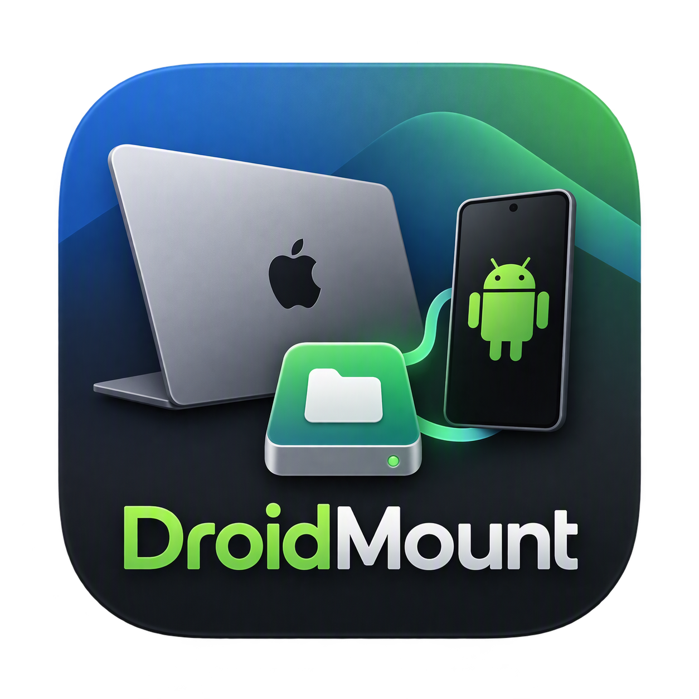
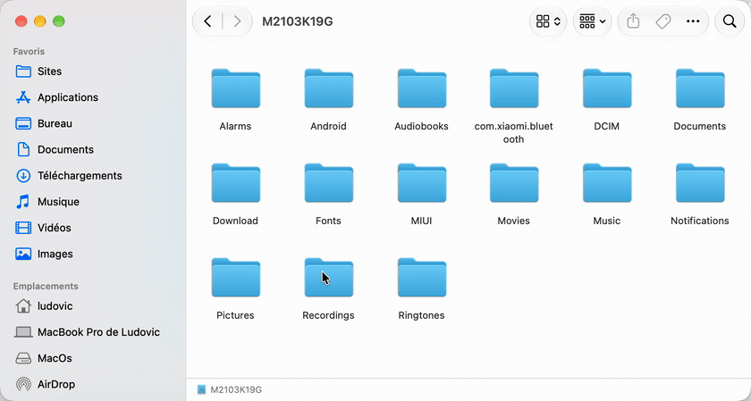

# DroidMount

<p align="center">
  
</p>

<p align="center">
  
</p>

<p align="center">
<em>Plug your phone → it appears in Finder → drag & drop files.</em>
</p>

**Mount your Android device's storage as a native network volume on macOS — over USB, no root, no companion app.**

DroidMount is a lightweight macOS menu bar app that makes your Android phone's storage appear in Finder like any other network drive. It detects your connected device via **ADB** (Android Platform Tools), bridges it to a small built-in **WebDAV server**, and lets the Finder mount it natively as a read/write volume.

No kernel extensions (macFUSE), no third-party Android app to install, no drama.

---

## ✨ Features

| Feature | Description |
|---|---|
| 🔌 **USB via ADB** | Device auto-detection, port tunneling over the USB cable — no Wi-Fi needed |
| 🗂 **True Finder volume** | Read/write network volume mounted by macOS's native WebDAV client |
| ⚡ **Auto-mount / auto-eject** | Mounts on connection, ejects on disconnection |
| 🧠 **Manual eject respect** | Ejected volume stays ejected until you unplug & replug the device |
| 🖥 **Menu bar UI** | Device status, mount/eject/Finder shortcut, free space |
| 🚀 **Launch at login** | Optional, via standard `SMAppService` |
| 🔧 **Configurable** | Local port, storage root path (defaults to `/storage/emulated/0`) |
| 🍃 **Zero footprint on Android** | Only standard USB debugging (ADB), already trusted by millions of devs |
| 🧹 **Clean shadows** | AppleDouble `. _*` files kept away, clean eject on quit |

## 🏗 How it works

```
┌──────────────┐   USB/ADB    ┌──────────────────┐  localhost:5059  ┌───────────────┐
│ Android 📱   │ ◄──────────► │  DroidMount      │ ◄──────────────► │  macOS Finder │
│ (toybox shell│  ls/mkdir/rm │  built-in Swift  │  WebDAV bridge   │  native webdav│
│  + adb pull/ │  pull/push   │  WebDAV server   │  (HTTP chunks +  │  mount (RW)   │
│  push)       │              │                  │  100-continue)   │               │
└──────────────┘              └──────────────────┘                  └───────────────┘
```

Every WebDAV verb (`PROPFIND`, `GET`, `PUT`, `MKCOL`, `DELETE`, `MOVE`, `COPY`, `LOCK`…) is bridged
on the fly to the equivalent adb command (`ls -la`, `mkdir`, `rm -rf`, `mv`, `cp -R`, `adb pull/push`).
The Finder therefore talks to a real volume — that it mounts read-write since the server
advertises DAV class 2 (locking) — and nothing but adb is needed on the phone.

## 📦 Requirements

- macOS **14.0+** (Sonoma or newer) — works on Apple Silicon & Intel
- **Android Platform Tools** (provides `adb`):
  ```bash
  brew install --cask android-platform-tools
  ```
- An Android device with **USB debugging** enabled (Developer options)

## 🚀 Getting started

### Build from source

```bash
git clone https://github.com/<your-username>/DroidMount.git
cd DroidMount
xcodegen generate
xcodebuild build -project DroidMount.xcodeproj -scheme DroidMount -configuration Debug
# Or simply open DroidMount.xcodeproj in Xcode and hit ⌘R
```

### Use it

1. Launch **DroidMount** — a menu bar icon appears (disk)
2. Connect your Android device over USB and authorize USB debugging
3. Click the menu bar icon for status → the volume mounts automatically under the device name (e.g. `M2103K19G`)
4. Browse, copy, drag & drop — files land directly on your phone
5. Eject the volume (or click **Eject** in the menu bar) whenever

> **Note:** the app runs `adb` (detection every 3 s, listing shells, pull/push) — that's it.
> All data travels through the USB cable; no data ever leaves your Mac.

## 💡 Why another Android file transfer app?

Existing solutions fall in one of 3 buckets:

1. **MTP drag & drop apps** — clunky file dialogs, no Finder-like browsing, no background transfers.
2. **macFUSE-based mounts** — require installing a system extension, approve it in System Settings, sometimes reboot.
3. **Wi-Fi companion apps** — you must install + run a server app on the phone every time.

DroidMount takes the 4th road: **ADB as backbone** + **Finder native WebDAV mount**, a combination that keeps the phone stock and the Mac kernel extension–free.

## 🧱 Tech

- **Swift 5 / SwiftUI** (`MenuBarExtra` window style popover)
- Custom **HTTP/WebDAV server** written with Apple's `Network.framework` — implements:
  - `OPTIONS`, `PROPFIND` (depth 0/1), `GET`/`HEAD` with **HTTP Range** support,
  - `PUT` with both **Content-Length** and Finder's famous **`Transfer-Encoding: chunked`** (streamed to disk),
  - `Expect: 100-continue` acknowledgment,
  - `MKCOL`, `DELETE`, `MOVE`, `COPY`, `PROPPATCH`, `LOCK`/`UNLOCK` (class 2 → forces RW mounts).
- Asynchronous **adb** wrapper — device listing, `test -d/-e`, port-forward style transfers
- Robust `ls -la` parser (toybox **and** BSD date formats, multi-space alignment handling)
- Clean shutdown: server stop, temp-file cache cleanup, sync unmount of the volume on quit

## 🧪 Troubleshooting

| Issue | Fix |
|---|---|
| *adb introuvable* | `brew install --cask android-platform-tools` then relaunch |
| Device not detected | Check `adb devices` reveals test — most often, authorize the "USB debugging" dialog on the phone |
| Unauthorized state | Replug + confirm the fingerprint dialog on the phone |
| Finder says "Connection not secure" | Expected — the bridge listens on `localhost` only, nothing leaves your machine. Click **Allow**. |
| Volume stays ejected | Unplug the USB cable and re-plug to re-enable auto-mount |

## 📜 License

MIT — see [LICENSE](LICENSE).

---

<p align="center">Made with Swift, ADB and one good cable-cable. 📱⚡️💻</p>
